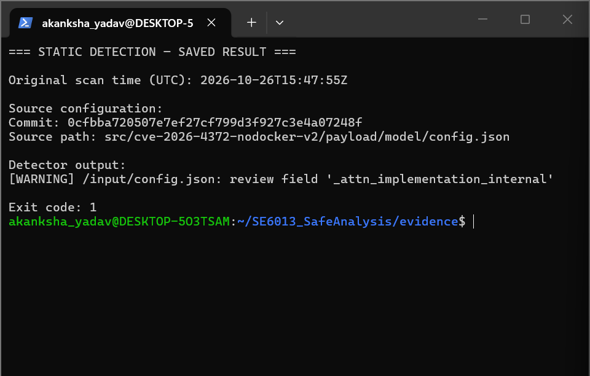
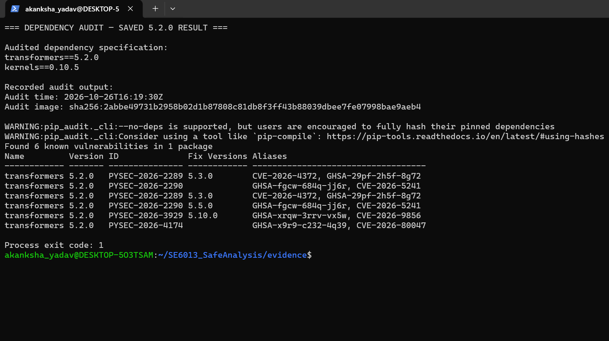
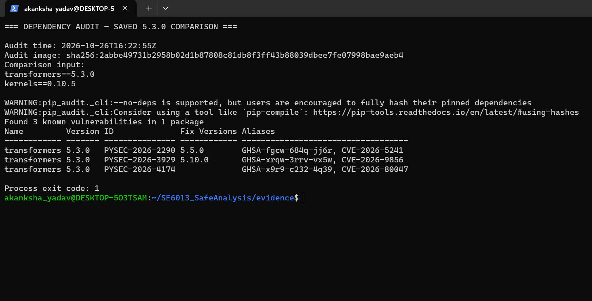

# Detection: usage and validation

This guide supplements Section 6 of the main project README. The two Python scripts remain separate: `static_detector.py` inspects a JSON file; `dependency_detector.py` inspects the Python environment that runs it. `pip-audit` is a separate external tool, not part of either script.

## Validation status

| Check | Recorded result | Scope |
|---|---|---|
| Static unit tests | 8/8 passed | Synthetic configurations and input-error cases |
| Team's `nodocker-v2` configuration | `_attn_implementation_internal` flagged; exit code 1 | Exported repository file; model not loaded |
| Declared Transformers 5.2.0 / kernels 0.10.5 | CVE-2026-4372 reported | Advisory lookup, not an installed-environment inspection |
| Declared Transformers 5.3.0 / kernels 0.10.5 | Target CVE not reported; three other CVEs remained | Comparison specification, not a patch-execution test |
| Installed-environment checker | Clean-container check and limited simulated-version tests completed | Still needs validation in the actual victim environment |
| Runtime detection | Not validated | Separate from the checks documented here |

The recorded static scan and advisory audits ran in restricted Docker containers on the detection developer's machine. The direct commands below are provided for the existing disposable lab/cloud pod; they have not yet been validated in Alvin's pod.

## Safety and prerequisites

Do not run the attack's `setup.sh`, `attacker.sh`, `victim.sh`, `victim_test.py`, or import its payload to perform these checks. No Hugging Face login or shared token is needed to scan a local configuration.

For direct execution, use the team's existing disposable lab environment, not a personal host containing credentials. The scanner uses the Python standard library. The environment checker also needs `packaging` when Transformers is present. The separate advisory audit uses `pip-audit` 2.10.1 and internet access.

Commands in this guide do not install Transformers or kernels. The optional tooling setup installs only `pip-audit` and its dependencies. It does not provide an operating-system sandbox.

## 1. Scan the team's configuration

From the repository root, in a checkout containing both the detection scripts and the `nodocker-v2` lab:

```bash
scan_status=0
python3 -I -B src/detection/static_detector.py \
  src/cve-2026-4372-nodocker-v2/payload/model/config.json \
  || scan_status=$?
printf 'Scanner exit code: %s\n' "$scan_status"
```

Alternatively, replace the JSON path with the path to a separately exported configuration. Pass the file to the detector, not to Transformers.

The scanner recursively checks for these four field names:

- `_attn_implementation_internal`
- `_experts_implementation_internal`
- `auto_map`
- `custom_pipelines`

It does not inspect or execute the code referenced by their values. The latter two fields can be legitimate; they are review indicators, not proof of this CVE. A nested match also does not establish that Transformers would interpret that location as an exploit trigger.

| Scanner exit code | Meaning |
|---|---|
| 0 | No monitored fields found; not a guarantee of safety |
| 1 | A monitored field requires review |
| 2 | Usage, file-reading, JSON parsing or input-structure error |

### Observed result

```text
[WARNING] /input/config.json: review field '_attn_implementation_internal'

Exit code: 1
```

Alvin confirmed that the configuration at the `nodocker-v2/payload/model/config.json` path was used in his successful demonstration. The detection evidence records the source commit and SHA-256 of the exported repository file. A byte-for-byte comparison with the file on the running pod has not been performed.



## 2. Check the actual victim Python environment

Use the interpreter from the victim's existing environment, not the separate audit-tool environment. Activate the existing victim virtual environment if the lab uses one, then run from the repository root:

```bash
python -I -B src/detection/dependency_detector.py
```

This reports the Transformers distribution version, the kernels distribution version, and whether Python's module-discovery mechanism can find kernels. It then classifies the version using the implemented range `4.56.0 <= version < 5.3.0` and reports package availability. The range remains a rule to reconcile with the team's source analysis, not proof of exploitability.

If `packaging` is missing, stop and resolve that tooling requirement in the controlled lab; do not install the vulnerable model stack on a personal machine.

**Important limitations:**

- The current script prints warnings but does not return dedicated nonzero security-warning exit codes. Do not use its exit status as a blocking control.
- Earlier 5.2.0/5.3.0 tests simulated package metadata and substituted the version parser. They were limited logic tests, not validation of real installations or all version formats.
- Finding kernels through module discovery is not a test that the payload can execute.
- The actual victim environment, including the kernels-present case, still needs to be checked.

## 3. Audit declared dependencies without installing them

These audits are separate from `dependency_detector.py`. The original `requirements-vulnerable.txt` and `requirements-patched.txt` contain only Transformers. The saved newer comparison included kernels 0.10.5 as well. The commands below recreate that two-package comparison.

### Optional: prepare separate audit tooling in the disposable pod

Skip this preparation if the team already has a trusted audit environment with `pip-audit` 2.10.1. Do not install the auditing tool into the victim environment solely for this comparison.

```bash
(
  set -eu
  tools="$HOME/se6013-audit-tools"
  if [ -e "$tools" ]; then
    echo 'STOP: audit-tools directory already exists; inspect it before reuse.'
    exit 1
  fi
  python3 -m venv "$tools"
  "$tools/bin/python" -I -B -m pip \
    --isolated --disable-pip-version-check install \
    --only-binary=:all: --no-cache-dir \
    --index-url https://pypi.org/simple \
    'pip-audit==2.10.1'
)
```

This direct tooling setup is provided for the pod; the recorded results used a separately prepared Docker image instead.

### Query the two specifications

The temporary directory below holds only plain-text package lists and logs, not installed packages. Use the audit environment prepared above, or change `audit_python` to another reviewed audit interpreter.

```bash
(
  set -eu
  audit_python="$HOME/se6013-audit-tools/bin/python"
  "$audit_python" -I -B -m pip_audit --version

  inputs=$(mktemp -d /tmp/se6013-audit-inputs.XXXXXX)
  printf 'transformers==5.2.0\nkernels==0.10.5\n' > "$inputs/lab.txt"
  printf 'transformers==5.3.0\nkernels==0.10.5\n' > "$inputs/comparison.txt"

  for name in lab comparison; do
    report="$inputs/$name-audit.txt"
    date -u '+Audit time: %Y-%m-%dT%H:%M:%SZ' > "$report"
    cat "$inputs/$name.txt" >> "$report"
    audit_status=0
    "$audit_python" -I -B -m pip_audit \
      --vulnerability-service pypi \
      --no-deps --disable-pip --strict \
      --aliases on --desc off --progress-spinner off --timeout 30 \
      -r "$inputs/$name.txt" >> "$report" 2>&1 || audit_status=$?
    printf '\nProcess exit code: %s\n' "$audit_status" >> "$report"
    cat "$report"
  done
  printf '\nPackage lists and reports: %s\n' "$inputs"
)
```

Keep `--no-deps --disable-pip` and do not add `--fix`. This checks the specified packages without installing or resolving the lab stack. It is not a complete environment audit. A completed audit can return 1 for vulnerability findings, but errors can also produce a nonzero exit; inspect the complete output.

### Recorded comparison

Audits ran on **26 October 2026 UTC / 27 October 2026 Singapore time**, using `pip-audit` 2.10.1. Database results may change.

| Transformers | kernels | Advisory rows | Distinct CVE IDs in the output | CVE-2026-4372 |
|---|---|---:|---:|---|
| 5.2.0 | 0.10.5 | 6 | 4 | Reported; listed fix 5.3.0 |
| 5.3.0 | 0.10.5 | 3 | 3 | Not reported |

The 5.2.0 output repeats two advisory IDs. **Three fewer rows does not mean three distinct vulnerabilities fixed.** Only one distinct CVE disappears between the saved outputs. The comparison still reports CVE-2026-5241, CVE-2026-9856 and CVE-2026-80047. No finding was listed for kernels; that does not establish that it is harmless or irrelevant to the attack.

The mapping for the target finding is `PYSEC-2026-2289` / `CVE-2026-4372` / `GHSA-29pf-2h5f-8g72`.





## 4. Synthetic tests

From the repository root, in a controlled development environment:

```bash
(
  cd src/detection || exit 1
  python3 -B -m unittest -v test_detection.py
)
```

The recorded Docker run passed all eight tests: benign JSON; the four monitored fields; a nested field; malformed JSON; and a missing file. Expected warning/error messages are part of those tests. These results do not establish real-world detection accuracy or a false-positive rate.

## 5. Evidence and remaining work

The screenshots display saved outputs, not additional executions. Original text logs, the source commit, input/scanner fingerprints, tool image identifiers and timestamps are retained with the local detection evidence. Review selected records for credentials and personal information before publishing them.

Remaining validation: run the environment checker with the actual victim interpreter, validate the direct pod instructions, and keep any runtime monitoring separate from static/advisory claims. These detection checks do not demonstrate prevention; that is evaluated by the Defence component.

## Tool references

- [pip-audit documentation](https://github.com/pypa/pip-audit)
- [Python command-line options](https://docs.python.org/3.12/using/cmdline.html)
